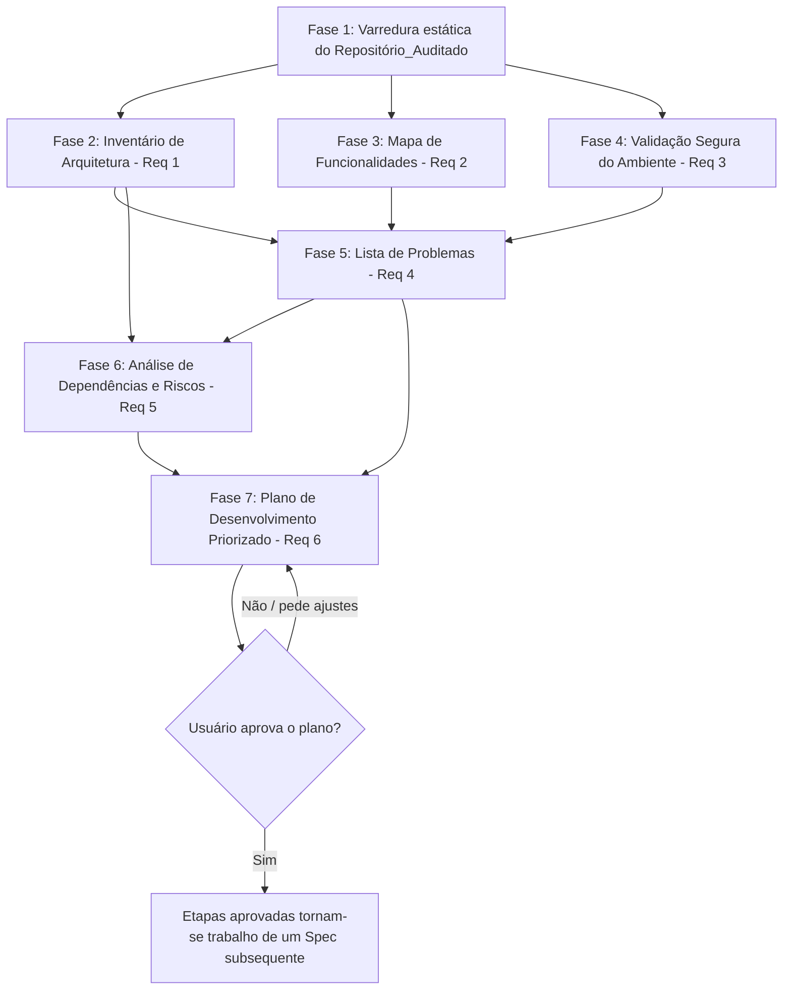

# Documento de Design

## Overview

Este design descreve **como a Auditoria será conduzida**, não uma funcionalidade de software a ser implementada no `universal-media-downloader`. O "sistema" projetado aqui é o próprio processo de auditoria: um conjunto de atividades de inspeção estática de código e de verificação read-only do ambiente, cujo produto final são seis documentos Markdown depositados dentro de `.kiro/specs/codebase-technical-audit/`.

Nenhuma etapa deste design envolve alterar código de produção do Repositório_Auditado, instalar dependências, executar chamadas de rede ou excluir/sobrescrever arquivos. O Auditor atua exclusivamente como leitor e documentador. Qualquer necessidade de Ação_De_Ambiente ou Ação_Destrutiva identificada durante a execução é registrada como pendente de autorização, nunca executada por iniciativa própria.

O design cobre os seis Requisitos do `requirements.md`:

| Requisito | Entregável | Arquivo de saída |
|---|---|---|
| 1 | Inventário de Arquitetura | `01-inventario-arquitetura.md` |
| 2 | Mapa de Funcionalidades | `02-mapa-funcionalidades.md` |
| 3 | Validação Segura do Ambiente | `03-validacao-ambiente.md` |
| 4 | Lista de Problemas | `04-lista-problemas.md` |
| 5 | Análise de Dependências e Riscos | `05-analise-dependencias-riscos.md` |
| 6 | Plano de Desenvolvimento Priorizado | `06-plano-desenvolvimento.md` |

Todos os arquivos residem em `.kiro/specs/codebase-technical-audit/`, lado a lado com `requirements.md` e este `design.md`, satisfazendo o Critério 1.6 (nome identificável e distinto por Requisito).

## Architecture

### Visão geral do processo de auditoria

A auditoria é executada em fases sequenciais, pois os entregáveis posteriores dependem dos dados coletados nas fases anteriores (o Plano de Desenvolvimento do Requisito 6, por exemplo, depende diretamente dos achados dos Requisitos 1 a 5):

- **Fase 1 — Varredura estática**: leitura de todos os Módulos Python do Repositório_Auditado, sem execução de código do projeto (nenhum `import` dinâmico, nenhuma instância de `Downloader`, `FormatSelector` ou `FFmpegService` é executada; a leitura é puramente textual/AST). Esta fase alimenta os Requisitos 1, 2, 4 e 5.
- **Fases 2 a 4** podem ocorrer em paralelo entre si, pois usam a mesma varredura estática (Fase 1) mas produzem documentos independentes. A Fase 4 (Validação Segura do Ambiente) é isolada das demais pois não depende de leitura de código-fonte, apenas de inspeção do ambiente local.
- **Fase 5 (Lista de Problemas)** depende dos achados estruturais do Inventário (Req 1), dos gaps do Mapa de Funcionalidades (Req 2) e dos resultados de Verificação_Segura (Req 3), pois um Problema pode ser evidenciado por qualquer uma dessas três fontes.
- **Fase 6 (Dependências e Riscos)** depende do Inventário de Arquitetura (grafo de imports) e da Lista de Problemas (riscos já confirmados como Problema não são duplicados, apenas referenciados).
- **Fase 7 (Plano de Desenvolvimento)** consolida os achados das Fases 2 a 6 em etapas priorizadas e permanece em estado "proposto" até resposta explícita do usuário.

### Guardrails arquiteturais (transversais a todas as fases)

Estes guardrails são restrições de execução do próprio Auditor, aplicadas em toda a arquitetura:

1. **Somente leitura de código**: nenhuma chamada de ferramenta de escrita (`fs_write`, `str_replace`, `fs_append`, `delete_file`) é usada sobre arquivos em `app/`, `main.py`, `README.md` ou qualquer arquivo de configuração/dependência do projeto. Essas ferramentas só são usadas para criar/atualizar os seis arquivos Markdown de saída dentro do diretório do Spec.
2. **Sem Ação_De_Ambiente**: nenhum comando que instale, atualize ou remova pacotes (`pip install`, `pip uninstall`, etc.) é executado. Comandos de terminal usados na Fase 4 são estritamente de consulta (ex.: listar pacotes já instalados, localizar executáveis no PATH).
3. **Sem Ação_Destrutiva**: nenhuma exclusão, sobrescrita ou movimentação de arquivos do Repositório_Auditado (incluindo `downloads/`).
4. **Sem chamadas de rede**: nenhuma análise de URL real, nenhum teste de conectividade, nenhum download de teste, nenhuma consulta a serviços externos (Requisito 3.4). Isso inclui não invocar `yt_dlp.YoutubeDL.extract_info` contra uma URL real.
5. **Autorização explícita antes de qualquer exceção**: se, durante a execução, surgir a necessidade de uma Ação_De_Ambiente ou Ação_Destrutiva para completar uma verificação (por exemplo, instalar uma dependência ausente para confirmar sua versão), o Auditor interrompe aquela verificação específica, registra o motivo em `03-validacao-ambiente.md` (Critério 3.3) e segue com as demais verificações.

## Components and Interfaces

Como este é um Spec diagnóstico, os "componentes" são as atividades/métodos de auditoria aplicados pelo Auditor, não classes de software. Cada componente abaixo corresponde a um método repetível que pode ser aplicado por um humano ou por um agente de IA seguindo os mesmos passos.

### Componente 1: Leitor de Módulos (alimenta Req 1, 2, 4, 5)

**Responsabilidade**: produzir, para cada Módulo em `app/core`, `app/gui`, `app/models`, `app/services`, `app/utils` e `main.py`, uma ficha estruturada de inspeção.

**Método/algoritmo**:
1. Enumerar todos os arquivos `*.py` nos diretórios listados, incluindo `__init__.py`, excluindo `__pycache__` e `*.pyc` (Critério 1.1).
2. Para cada arquivo, ler o conteúdo integral e extrair, por inspeção textual/estrutural (sem executar o código):
   - **Imports**: todas as linhas `import ...` e `from ... import ...`, filtrando as que referenciam outro Módulo do Repositório_Auditado (prefixo `app.` ou import relativo `.`/`..`) para montar o grafo de dependências internas (Critério 1.2, 5.1).
   - **Classes e funções públicas**: toda `class Nome` ou `def nome(...)` em nível de módulo ou método de classe cujo identificador não inicie com `_` (Critério 1.2). Funções/métodos iniciados com `_` são tratados como privados e não listados como "públicos", mas podem ser citados ao descrever o comportamento interno.
   - **Docstrings/comentários**: presença de docstring (`"""..."""` imediatamente após a definição) ou comentário `#` explicativo acima da definição.
3. Classificar o Módulo quanto a conteúdo:
   - **Vazio**: arquivo sem nenhuma linha de código executável (apenas linhas em branco e/ou comentários) → Critério 1.5.
   - **Placeholder**: conteúdo limitado a imports, `pass`, ou estrutura mínima sem lógica de negócio (ex.: `app/gui/__init__.py`, `app/services/__init__.py`, `app/utils/__init__.py`, hoje vazios, confirmados por leitura direta) → Critério 1.5.
   - **Implementado**: contém lógica de negócio executável.
4. Quando a responsabilidade de uma classe/função/arquivo não estiver documentada (sem docstring/comentário), o Auditor infere a responsabilidade a partir da leitura do corpo do código e sinaliza explicitamente a inferência com a marcação `(responsabilidade inferida)` no Inventário (Critério 1.4).

**Saída consumida por**: Inventário de Arquitetura (Req 1), base factual para Mapa de Funcionalidades (Req 2), Lista de Problemas (Req 4) e Análise de Dependências (Req 5).

### Componente 2: Classificador de Funcionalidades (alimenta Req 2)

**Responsabilidade**: classificar cada Funcionalidade do domínio como "Implementada", "Parcialmente implementada" ou "Ausente".

**Método/algoritmo**:
1. Definir a lista mínima de Funcionalidades a avaliar, conforme Critério 2.5: análise de mídia via `yt-dlp` (`Downloader.analyze`), seleção de formatos de vídeo e áudio (`FormatSelector.select`), download de formato único (`Downloader._download_single_format`), download com merge via FFmpeg (`Downloader._download_and_merge` + `FFmpegService.merge`), e existência de interface gráfica (`app/gui`).
2. Para cada Funcionalidade, descrever o comportamento esperado (com base no nome, docstrings e uso observado em `main.py`, que serve como especificação de uso de referência).
3. Aplicar critérios objetivos de classificação (Critério 2.2):
   - **Implementada**: todo o comportamento esperado está presente e executável no código (ex.: download de formato único está implementado de ponta a ponta em `Downloader._download_single_format`).
   - **Parcialmente implementada**: parte do comportamento esperado existe, parte está ausente/incompleta (critério objetivo: existe ao menos uma função pública ou privada que implementa parte do fluxo, mas falta tratamento de pelo menos um caso citado no comportamento esperado, ou falta integração ponta a ponta até a camada de usuário).
   - **Ausente**: nenhum código correspondente é encontrado (ex.: `app/gui` contém apenas `__init__.py` vazio → interface gráfica Ausente).
4. Para Funcionalidades "Implementada" ou "Parcialmente implementada", citar arquivo e linhas/intervalos exatos (Critério 2.3).
5. Para "Parcialmente implementada", descrever explicitamente o que está presente e o que falta (Critério 2.4).
6. Para áreas inteiras sem implementação (interface gráfica, persistência de histórico, testes automatizados — confirmado ausente por `file_search` sem resultados para `test_*.py`/`*_test.py`), registrar como "Ausente" indicando os diretórios verificados (Critério 2.6).

### Componente 3: Verificador Seguro de Ambiente (alimenta Req 3)

**Responsabilidade**: executar exclusivamente Verificação_Segura sobre o ambiente local, sem Ação_De_Ambiente, Ação_Destrutiva ou chamada de rede.

**Método/algoritmo** (cada item é uma verificação read-only isolada; falha em uma não impede as demais):
1. **Arquivos de definição de dependências** (Critério 3.5): verificar, por listagem de diretório do repositório raiz, a presença/ausência de `requirements.txt`, `pyproject.toml`, `Pipfile`, `setup.py`/`setup.cfg`. Resultado já confirmado nesta auditoria: nenhum desses arquivos existe no repositório.
2. **Arquivos de teste automatizado** (Critério 3.6): buscar por padrão de nome `test_*.py` ou `*_test.py`, e por diretórios `tests`/`test`. Resultado já confirmado: nenhum arquivo ou diretório desse tipo existe.
3. **Pacotes instalados no `.venv`** (Critério 3.7): como não há `requirements.txt`/`pyproject.toml` (passo 1), não há lista de pacotes esperados para comparar. O Auditor documenta essa limitação e, de forma complementar e somente leitura, pode listar os pacotes de fato instalados no ambiente `.venv` (ex.: via inspeção do diretório `site-packages` ou comando read-only equivalente a `pip list` dentro do `.venv`, sem instalar/atualizar nada) para registrar o que está disponível, deixando explícito que não há uma lista declarada de dependências esperadas para contraste.
4. **FFmpeg/FFprobe no PATH** (Critério 3.8): verificação read-only (equivalente a `shutil.which("ffmpeg")`/`shutil.which("ffprobe")` ou `Get-Command` no PowerShell) para confirmar presença no PATH do sistema, sem executar merge real nem instalar nada.
5. Qualquer verificação que exigiria Ação_De_Ambiente (ex.: instalar `yt-dlp` para confirmar sua versão exata, caso não esteja instalado) é marcada como "pendente de autorização" e não executada (Critério 3.2, 3.3).
6. Nenhuma etapa deste componente analisa URLs de mídia reais, testa conectividade ou realiza downloads de teste (Critério 3.4).

### Componente 4: Detector de Problemas (alimenta Req 4)

**Responsabilidade**: identificar Problemas confirmados por evidência (código ou Verificação_Segura) e separar hipóteses não confirmáveis.

**Método/algoritmo**:
1. Usar a ficha de cada Módulo (Componente 1) e, para cada Módulo em `app/core` especificamente, verificar as cinco categorias obrigatórias do Critério 4.5:
   - **Tratamento de exceções**: mapear todos os blocos `try/except` e chamadas que podem lançar exceção sem captura correspondente (ex.: `Downloader.analyze` já trata `yt_dlp.utils.DownloadError` e `Exception` genericamente; `FFmpegService._resolve_ffmpeg_path` lança `FFmpegError` dentro de `__init__`, o que pode quebrar a construção do objeto sem tratamento no chamador em alguns pontos).
   - **Codificação de caracteres**: verificar uso de `encoding=`/`errors=` em leitura/escrita de arquivos e subprocessos (ex.: `FFmpegService.merge` já usa `encoding="utf-8", errors="replace"` no `subprocess.run`).
   - **Nomes de arquivo inválidos**: verificar sanitização de nomes de arquivo antes de criar caminhos (ex.: `Downloader._sanitize_filename` existe para o fluxo de merge, mas `_download_single_format` usa `%(title)s.%(ext)s` diretamente no `outtmpl`, sem sanitização equivalente).
   - **Concorrência/bloqueio de interface**: verificar se chamadas potencialmente bloqueantes (`yt_dlp.extract_info`, `subprocess.run` do FFmpeg) são executadas de forma síncrona e bloqueante (relevante especialmente se uma GUI vier a ser implementada em `app/gui`).
   - **Limpeza de arquivos temporários**: verificar uso de `TemporaryDirectory` e se falhas no meio do fluxo deixam arquivos órfãos (ex.: `_download_and_merge` usa `TemporaryDirectory` com `with`, o que garante limpeza mesmo em exceção, mas o diretório é criado dentro do próprio destino do usuário com prefixo `umd_`).
   - Para cada categoria, registrar um Problema encontrado OU a declaração explícita "nenhum Problema identificado nesta categoria para este Módulo".
2. Para cada Problema, registrar: evidência (trecho de código ou resultado de Verificação_Segura), arquivo e linha/intervalo, e Gravidade.
3. Aplicar os critérios objetivos de Gravidade (Critério 4.3):
   - **Crítica**: impede execução básica do sistema ou causa perda de dados.
   - **Alta**: compromete funcionalidade central em cenário comum.
   - **Média**: afeta cenário secundário ou degrada qualidade sem impedir uso.
   - **Baixa**: inconsistência estética/estilo/manutenibilidade sem impacto funcional observável.
4. Problemas sem evidência direta de código nem resultado de Verificação_Segura são movidos para a seção "Hipóteses a Confirmar", com localização suspeita e justificativa da impossibilidade de confirmação (Critério 4.4) — por exemplo, suspeitas sobre comportamento em tempo de execução que dependeriam de executar o programa contra uma URL real, o que é proibido pelos guardrails (Requisito 3.4).
5. Ordenação final: Problemas confirmados por Gravidade decrescente (Crítica → Baixa) e, dentro da mesma Gravidade, por caminho de arquivo em ordem alfabética; seção de hipóteses sempre ao final (Critério 4.6).

### Componente 5: Mapeador de Dependências e Riscos (alimenta Req 5)

**Responsabilidade**: descrever o grafo de dependências internas e os riscos das Dependências_Externas `yt-dlp`, `FFmpeg` e `FFprobe`.

**Método/algoritmo**:
1. A partir do grafo de imports internos extraído pelo Componente 1, montar uma lista (ou diagrama Mermaid) de "Módulo X depende de Módulo Y" (Critério 5.1).
2. Para cada Dependência_Externa (`yt-dlp`, `FFmpeg`, `FFprobe`), localizar todos os pontos de integração por busca textual dos símbolos de uso (ex.: `import yt_dlp`, `yt_dlp.YoutubeDL`, `shutil.which("ffmpeg")`, `subprocess.run`) e registrar Módulo + função/método (Critério 5.2). Nota: o código atual não possui nenhum ponto de integração direto com `FFprobe` (apenas `FFmpeg` é referenciado em `FFmpegService`); isso é registrado como achado factual, não inferido.
3. Para cada ponto de integração, descrever risco técnico: indisponibilidade (ex.: FFmpeg ausente do PATH), incompatibilidade de versão (ex.: mudança de schema de `format_data` retornado por `yt-dlp` entre versões), alteração de comportamento (Critério 5.3).
4. Verificar, para cada chamada a uma Dependência_Externa, se há checagem prévia de disponibilidade e captura de exceção específica; registrar ausência como risco técnico quando aplicável (Critério 5.4) — por exemplo, `Downloader.analyze` e `_download_single_format` não chamam `FFmpegService` e não dependem de checagem prévia de FFmpeg, mas também não verificam previamente se `yt-dlp` está operacional antes de instanciar `YoutubeDL`.
5. Avaliar acoplamento entre `downloader.py`, `format_selector.py` e `ffmpeg_service.py` (Critério 5.5): identificar se a dependência é por injeção (ex.: `Downloader.__init__(self, ffmpeg_service: FFmpegService | None = None)` permite injeção, mas `_download_and_merge` instancia `FFmpegService()` diretamente quando `self._ffmpeg_service is None`, o que impede substituição completa por um fake nesse caminho específico de código já em posse de uma instância `None` inicial) e citar os trechos exatos que impedem substituição por fake/mock em teste automatizado.

### Componente 6: Planejador Priorizado (alimenta Req 6)

**Responsabilidade**: consolidar achados dos Componentes 1 a 5 em etapas pequenas, priorizadas e com critérios de aceitação verificáveis, mantidas em estado "proposto".

**Método/algoritmo**:
1. Para cada Problema confirmado (Req 4), cada Funcionalidade "Ausente"/"Parcialmente implementada" (Req 2) e cada risco técnico (Req 5), criar uma etapa candidata com escopo limitado a um único item de origem (Critério 6.2).
2. Atribuir prioridade: igual à Gravidade do Problema de origem; ou uma Gravidade equivalente justificada por escrito quando a etapa vier de uma Funcionalidade ou de um risco técnico (Critério 6.3).
3. Ordenar etapas de Crítica → Baixa, documentando por escrito qualquer exceção motivada por dependência técnica entre etapas (ex.: "implementar testes automatizados" pode precisar vir antes de "refatorar acoplamento direto" para permitir verificação da refatoração) (Critério 6.4).
4. Marcar todas as etapas com rótulo de estado `Proposto` no cabeçalho do documento e no início de cada etapa.
5. Nenhuma etapa é iniciada, nenhum código é alterado como consequência do plano dentro deste Spec (Critério 6.6, 6.8). Caso o usuário solicite ajustes, o plano é revisado e as etapas revisadas permanecem `Proposto` (Critério 6.7). Caso o usuário manifeste concordância explícita com o plano como um todo, isso é registrado no documento, mas a implementação em si é tratada como trabalho de um Spec subsequente, nunca executada dentro desta Auditoria (Critério 6.8).

## Data Models

> Nota: neste Spec diagnóstico, os "modelos de dados" são os esquemas estruturais dos artefatos Markdown de saída (não há modelos de dados de software a implementar).

Não há modelos de dados de software a implementar; os "modelos de dados" desta auditoria são os esquemas estruturais dos seis documentos Markdown produzidos. Cada um é criado uma única vez e pode ser atualizado (sobrescrito pelo Auditor, nunca pelo usuário final) conforme a auditoria avança ou recebe feedback.

### `01-inventario-arquitetura.md` (Requisito 1)
- Seção por diretório (`app/core`, `app/gui`, `app/models`, `app/services`, `app/utils`, `main.py`).
- Por Módulo: caminho do arquivo; responsabilidade (com marcação `(responsabilidade inferida)` quando aplicável); classes/funções públicas; dependências internas (imports de outros Módulos); status `vazio/placeholder` quando aplicável.
- Seção dedicada de fluxo de dados entre `downloader.py`, `format_selector.py`, `ffmpeg_service.py` e `app/models`.

### `02-mapa-funcionalidades.md` (Requisito 2)
- Uma entrada por Funcionalidade: nome, comportamento esperado, classificação (`Implementada`/`Parcialmente implementada`/`Ausente`), referências a arquivo/linhas, e — quando parcial — lista do que está presente vs. ausente.
- Cobertura mínima garantida: análise via yt-dlp, seleção de formatos, download único, download com merge, interface gráfica.

### `03-validacao-ambiente.md` (Requisito 3)
- Tabela de verificações: item verificado, método (comando/consulta read-only usado), resultado, classificação (`Verificado` / `Pendente de autorização` / `Não aplicável`).
- Seção explícita listando o que requer Ação_De_Ambiente ou Ação_Destrutiva e não foi executado, com justificativa.

### `04-lista-problemas.md` (Requisito 4)
- Seção "Problemas Confirmados", ordenada por Gravidade decrescente e, dentro da mesma Gravidade, por caminho de arquivo alfabético. Cada item: título, evidência, arquivo:linha(s), Gravidade.
- Subseção explícita por Módulo de `app/core` cobrindo as cinco categorias do Critério 4.5.
- Seção "Hipóteses a Confirmar", com localização suspeita e motivo da não confirmação.

### `05-analise-dependencias-riscos.md` (Requisito 5)
- Diagrama Mermaid (ou lista estruturada) do grafo de dependências internas entre Módulos.
- Tabela de pontos de integração com `yt-dlp`/`FFmpeg`/`FFprobe`: Módulo, função/método, risco técnico associado.
- Seção de acoplamento entre `downloader.py`, `format_selector.py`, `ffmpeg_service.py`: tipo de dependência (injeção vs. instanciação direta) por par de Módulos, com trechos de código citados.

### `06-plano-desenvolvimento.md` (Requisito 6)
- Cabeçalho com estado geral do plano (`Proposto` até aprovação explícita).
- Lista de etapas ordenadas por prioridade, cada uma com: título, escopo (Problema/Funcionalidade/risco de origem), prioridade, critérios de aceitação verificáveis, estado (`Proposto`).
- Seção de justificativas para qualquer reordenação por dependência técnica entre etapas.

## Error Handling

Como este Spec não implementa software, "tratamento de erros" refere-se a como o próprio processo de auditoria lida com situações excepcionais durante a inspeção:

- **Módulo ilegível ou binário inesperado**: se um arquivo listado como Módulo não puder ser lido como texto, o Auditor registra esse Módulo no Inventário com status "não foi possível ler o conteúdo" em vez de interromper a auditoria inteira.
- **Dependência_Externa ausente durante Verificação_Segura**: a ausência de `FFmpeg`/`FFprobe` no PATH ou de pacotes no `.venv` não é tratada como falha da auditoria; é um resultado válido a ser documentado em `03-validacao-ambiente.md`.
- **Impossibilidade de confirmar um Problema suspeito**: nunca é descartado silenciosamente; é sempre movido para "Hipóteses a Confirmar" em `04-lista-problemas.md` com a justificativa específica (Critério 4.4).
- **Necessidade de Ação_De_Ambiente/Destrutiva no meio de uma verificação**: a verificação específica é interrompida sem executar a ação, o motivo é documentado, e as demais verificações independentes continuam normalmente (não é uma falha em cascata).
- **Divergência entre o código e o comportamento esperado assumido pelo Auditor**: quando o comportamento esperado de uma Funcionalidade não está documentado, o Auditor infere a partir do uso em `main.py` e do próprio código, sinalizando a inferência (consistente com Critério 1.4, aplicado também ao Requisito 2).
- **Feedback do usuário sobre o Plano de Desenvolvimento**: tratado como entrada de revisão, nunca como autorização implícita para iniciar implementação (Critério 6.6, 6.7) — somente concordância explícita e inequívoca com o plano como um todo é tratada como aprovação, e mesmo assim a execução ocorre em um Spec subsequente.

## Testing Strategy

*Estratégia de Verificação* — esta seção adapta a "Testing Strategy" tradicional, pois este Spec não produz código testável por testes automatizados — ele produz documentação derivada de inspeção estática e verificação de ambiente. Testes de propriedade (property-based testing) não se aplicam: não há função pura com espaço de entradas a ser exercitado; o "comportamento" sob auditoria é a correção e completude dos próprios documentos Markdown em relação ao código-fonte real e ao `requirements.md`.

A verificação da qualidade deste trabalho é feita por conferência manual/estrutural de cada entregável contra os Critérios de Aceitação do Requisito correspondente:

- **Verificação de completude por Requisito**: para cada Requisito (1 a 6), percorrer cada Critério de Aceitação e confirmar que o conteúdo do arquivo Markdown correspondente o satisfaz literalmente (ex.: todo Módulo em `app/core`/`app/gui`/`app/models`/`app/services`/`app/utils`/`main.py` aparece no Inventário; toda Funcionalidade mínima do Critério 2.5 aparece no Mapa; as cinco categorias do Critério 4.5 aparecem para cada Módulo de `app/core`; etc.).
- **Verificação de rastreabilidade**: cada Problema, risco técnico e etapa do plano deve referenciar arquivo e linha(s) reais do Repositório_Auditado — conferido relendo o trecho citado para confirmar que a citação corresponde ao código real (evita alucinação de linhas/trechos).
- **Verificação de guardrails**: antes de finalizar cada entregável, confirmar que nenhuma ferramenta de escrita foi usada sobre arquivos fora do diretório do Spec, nenhuma chamada de rede foi feita, e nenhuma Ação_De_Ambiente/Destrutiva foi executada sem autorização — revisando o próprio histórico de ações do Auditor na sessão.
- **Verificação cruzada entre documentos**: confirmar consistência entre os seis arquivos (ex.: um Módulo listado como "vazio/placeholder" no Inventário não pode aparecer como "Implementada" no Mapa de Funcionalidades para a mesma área; um risco do Requisito 5 referenciado no Plano do Requisito 6 deve usar a mesma descrição).
- **Revisão do usuário**: após a produção de cada arquivo (ou do conjunto, conforme preferir o usuário), o Auditor apresenta o conteúdo para revisão e aplica qualquer feedback antes de considerar aquela fase concluída, podendo retornar à clarificação de requisitos se um gap for identificado.

Testes automatizados de software (unitários ou de propriedade) ficam fora do escopo desta auditoria e, caso recomendados, aparecem apenas como uma etapa proposta dentro de `06-plano-desenvolvimento.md`, nunca implementados neste Spec.
