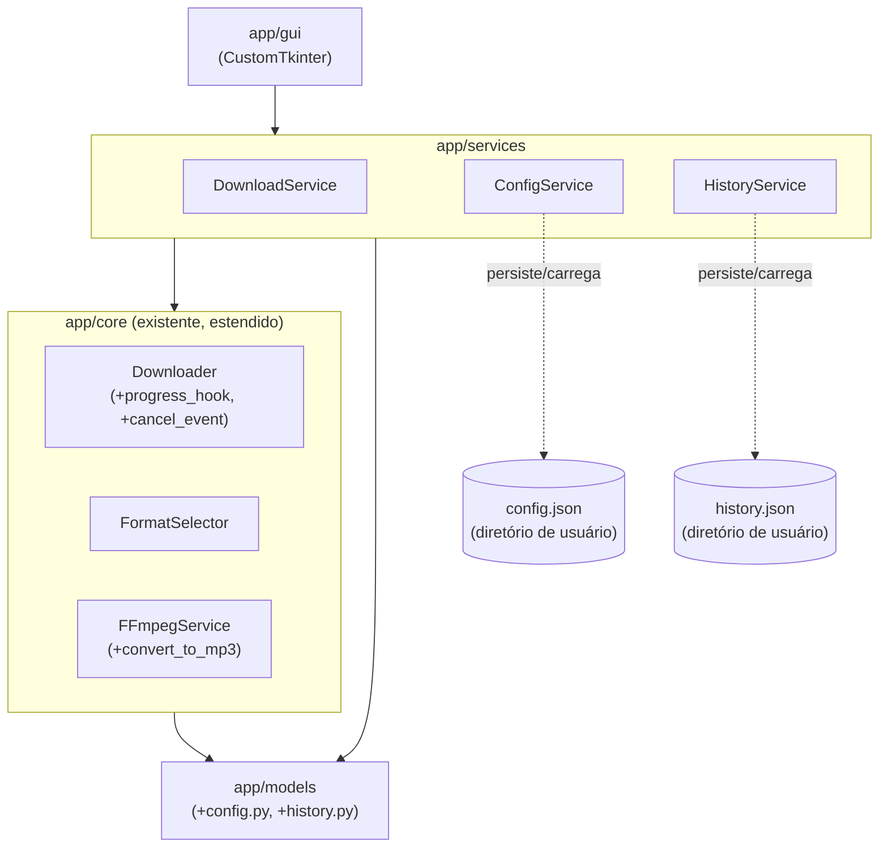

# Design Document

## Overview

O Universal Media Downloader é um aplicativo desktop Windows que permite analisar, selecionar, baixar, converter (MP3) e combinar (merge) mídia a partir de URLs suportadas pelo `yt-dlp`, com uma interface gráfica construída em CustomTkinter.

A base de código já possui uma camada **Core** funcional e estável:

- `app/models` — modelos de domínio (`FormatInfo`, `MediaType`, `MediaInfo`, `DownloadType`, `DownloadStatus`, `DownloadOptions`, `DownloadProgress`, `DownloadResult`, `FormatSelection`).
- `app/core/downloader.py` — `Downloader.analyze()` e `Downloader.download()`, incluindo download de formato único e download+merge via FFmpeg.
- `app/core/format_selector.py` — `FormatSelector.select()`, com pontuação e seleção de formatos de vídeo e áudio.
- `app/core/ffmpeg_service.py` — `FFmpegService`, responsável por localizar o executável do FFmpeg e executar merge sem recodificação.

Este design **estende** essa base, sem reescrevê-la:

- `FFmpegService` recebe um novo método `convert_to_mp3` para a Conversão_Para_MP3 (Requisito 6).
- `Downloader` recebe suporte opcional a `progress_hook` (Requisito 7) e a um `cancel_event` cooperativo (Requisito 8), além de unificar a sanitização de nomes de arquivo também no caminho de formato único (Requisito 11) e de acionar `convert_to_mp3` quando apropriado (Requisito 6).
- `FormatSelector` **não é alterado** — seu comportamento já atende aos Requisitos 2 e 3.

Sobre essa base, são construídos do zero:

- **Services** (`app/services`): `DownloadService`, `ConfigService`, `HistoryService` — orquestram o Core, executam operações em background, emitem progresso, aceitam cancelamento e expõem uma API única para a GUI (Requisitos 7, 8, 9, 10, 13, 14).
- **Models de suporte** (`app/models/config.py`, `app/models/history.py`): `AppConfig` e `HistoryEntry`.
- **GUI** (`app/gui`): janela principal CustomTkinter que depende exclusivamente de Services (Requisito 12).
- **Testes automatizados** (Requisito 15) e **empacotamento** com PyInstaller (Requisito 16).

## Architecture

### Camadas



Regras de dependência (Requisitos 10 e 12):

- A GUI importa apenas `app.services` e `app.models`. Nunca importa `Downloader`, `FormatSelector` ou `FFmpegService` diretamente.
- `DownloadService` compõe `Downloader`, `FormatSelector`, `FFmpegService`, `ConfigService` e `HistoryService`. Não reimplementa lógica de seleção de formato ou de invocação do FFmpeg.
- `FFmpegService` continua sendo o único módulo que invoca o executável do FFmpeg (Requisito transversal do requirements.md).

### Threading e comunicação com a GUI (Requisito 9)

Operações potencialmente demoradas (`analyze`, `download`, merge, conversão MP3) são executadas em uma worker thread, nunca na thread principal (thread da GUI).

- `DownloadService` usa `concurrent.futures.ThreadPoolExecutor` (um worker por operação ativa) para disparar `analyze`/`download` em background.
- Cada operação em background recebe um `operation_id` (ex.: `uuid4`) retornado imediatamente ao chamador, permitindo consulta e cancelamento posteriores.
- Atualizações de progresso e resultados finais são publicados em uma `queue.Queue` thread-safe por operação (ou em uma estrutura compartilhada protegida por lock, consultável via `get_progress(operation_id)`), e também entregues via callback registrado (`on_progress`, `on_complete`) quando fornecido.
- A GUI nunca lê a fila diretamente de uma thread de background: ela usa o mecanismo de agendamento do CustomTkinter/Tkinter (`.after(ms, callback)`) em um loop periódico para drenar a fila/consultar o estado e atualizar widgets exclusivamente na thread principal. Isso garante que nenhuma chamada de API do Tkinter ocorra fora da thread principal.
- Exceções não tratadas dentro do worker são capturadas pelo próprio `DownloadService` (nunca escapam da thread) e convertidas em um `DownloadProgress`/`DownloadResult` final com estado `FAILED` (Requisito 9.4).

### Cancelamento cooperativo (Requisito 8)

- Cada operação em background tem um `threading.Event` (`cancel_event`) associado, criado pelo `DownloadService` ao iniciar a operação.
- `DownloadService.cancel(operation_id)` apenas sinaliza o evento (`cancel_event.set()`) e retorna; não interrompe threads forçadamente.
- `Downloader` passa a aceitar um `cancel_event: threading.Event | None` opcional em `download()` e nos métodos internos de download (`_download_single_format`, `_download_to_directory`, `_download_and_merge`). O evento é verificado em pontos seguros:
  - Antes de iniciar o download de cada stream (vídeo/áudio).
  - Dentro do `progress_hook` passado ao `yt-dlp`, que pode levantar uma exceção de controle interna (ex.: `DownloadCancelled`) para interromper o `yt_dlp.YoutubeDL.extract_info` de forma limpa.
  - Antes de iniciar o merge/conversão via `FFmpegService`.
- Quando uma operação é interrompida por cancelamento, o `Downloader`/`DownloadService` garante que:
  - Nenhum arquivo final é escrito/substituído no diretório de destino a partir de dados parciais.
  - Arquivos temporários da operação (dentro do `TemporaryDirectory` usado em `_download_and_merge`, ou arquivos parciais do `yt-dlp`) são removidos.
- `DownloadService.cancel()` para um `operation_id` já em estado terminal (`COMPLETED`, `FAILED`, `CANCELLED`) é uma operação no-op, sem erro (Requisito 8.5).

## Components and Interfaces

### `app/core/ffmpeg_service.py` (estendido)

Novo método, adicionado à classe `FFmpegService` já existente:

```python
SUPPORTED_MP3_BITRATES: frozenset[int] = frozenset({128, 192, 256, 320})

class FFmpegService:
    ...  # merge() e demais métodos existentes permanecem inalterados

    def convert_to_mp3(
        self,
        audio_path: Path,
        output_path: Path,
        bitrate: int,
    ) -> Path:
        """
        Converte um arquivo de áudio para MP3 no bitrate informado.

        Levanta FFmpegError se:
        - bitrate não estiver em SUPPORTED_MP3_BITRATES (sem invocar o FFmpeg);
        - audio_path não existir;
        - o FFmpeg não estiver disponível;
        - o processo do FFmpeg retornar código != 0;
        - o arquivo de saída não existir após execução com sucesso.
        """
```

Comando gerado (análogo a `merge`, reaproveitando `_validate_input_file`, `is_available`, criação de diretório de saída):

```
ffmpeg -y -i {audio_path} -c:a libmp3lame -b:a {bitrate}k {output_path}
```

### `app/core/downloader.py` (estendido)

Assinaturas estendidas (compatíveis com as existentes via parâmetros opcionais, sem quebrar chamadores atuais):

```python
class Downloader:
    def __init__(
        self,
        ffmpeg_service: FFmpegService | None = None,
    ) -> None: ...  # inalterado

    def analyze(self, url: str) -> MediaInfo: ...  # inalterado

    def download(
        self,
        options: DownloadOptions,
        selection: FormatSelection,
        progress_hook: Callable[[DownloadProgress], None] | None = None,
        cancel_event: "threading.Event | None" = None,
    ) -> DownloadResult:
        """
        Comportamento existente preservado. Adicionalmente:
        - repassa progress_hook (adaptado ao formato de progress_hooks
          do yt-dlp) para emitir DownloadProgress durante o download;
        - verifica cancel_event nos pontos seguros descritos em
          'Cancelamento cooperativo';
        - quando options.download_type == DownloadType.AUDIO e
          options.audio_bitrate is not None, invoca
          FFmpegService.convert_to_mp3 sobre o áudio baixado antes de
          retornar o DownloadResult, removendo o arquivo intermediário
          não convertido.
        """
```

Mudança adicional (correção aditiva, Requisito 11): `_download_single_format` passa a usar `Downloader._sanitize_filename` no nome final do arquivo de formato único, da mesma forma que `_download_and_merge` já faz — unificando a sanitização usada em todos os caminhos de escrita de arquivo final.

`FormatSelector` e sua interface pública (`select`) **não são alterados** por este design.

### `app/services/download_service.py` (novo)

```python
from dataclasses import dataclass
from typing import Callable
from uuid import UUID

@dataclass(frozen=True)
class DownloadHandle:
    """Identificador de uma operação de análise ou download em curso."""
    operation_id: UUID

class DownloadService:
    """
    Orquestra Downloader, FormatSelector e FFmpegService, expondo uma
    API única e assíncrona para a GUI. Usa ConfigService para valores
    padrão e HistoryService para registrar o desfecho de cada operação.
    """

    def __init__(
        self,
        downloader: Downloader | None = None,
        format_selector: FormatSelector | None = None,
        ffmpeg_service: FFmpegService | None = None,
        config_service: "ConfigService | None" = None,
        history_service: "HistoryService | None" = None,
    ) -> None: ...

    def analyze(
        self,
        url: str,
        on_complete: Callable[[MediaInfo | None, str | None], None] | None = None,
    ) -> DownloadHandle:
        """Inicia a análise de uma URL em background."""

    def start_download(
        self,
        media: MediaInfo,
        options: DownloadOptions,
        on_progress: Callable[[DownloadProgress], None] | None = None,
        on_complete: Callable[[DownloadResult], None] | None = None,
    ) -> DownloadHandle:
        """
        Seleciona formato(s) via FormatSelector, inicia download em
        background, emite progresso e registra o resultado no
        HistoryService ao concluir, falhar ou ser cancelado.
        """

    def cancel(self, operation_id: UUID) -> None:
        """Solicita cancelamento cooperativo; no-op se já terminal."""

    def get_progress(self, operation_id: UUID) -> DownloadProgress | None:
        """Consulta o progresso mais recente de uma operação."""
```

### `app/services/config_service.py` (novo)

```python
class ConfigService:
    """Carrega e persiste AppConfig em um arquivo JSON no diretório de
    configuração do usuário (ex.: %APPDATA%/UniversalMediaDownloader)."""

    def __init__(self, config_path: Path | None = None) -> None: ...

    def load(self) -> AppConfig:
        """
        Retorna a Configuração persistida. Se o arquivo não existir,
        estiver corrompido ou ilegível, retorna AppConfig com valores
        padrão, sem lançar exceção.
        """

    def save(self, config: AppConfig) -> None:
        """Persiste a Configuração em disco, criando diretórios
        necessários."""
```

### `app/services/history_service.py` (novo)

```python
class HistoryService:
    """Registra e consulta o Histórico_De_Downloads, persistido em um
    arquivo JSON (lista de entradas) no diretório de dados do usuário.

    JSON foi escolhido em vez de SQLite por simplicidade: o volume de
    entradas é baixo (uso pessoal, não concorrente entre processos) e
    não há necessidade de consultas relacionais."""

    def __init__(self, history_path: Path | None = None) -> None: ...

    def add_entry(self, entry: HistoryEntry) -> None:
        """Acrescenta uma entrada e persiste imediatamente."""

    def list_entries(self) -> list[HistoryEntry]:
        """
        Retorna as entradas na ordem de inserção (cronológica),
        indicando via HistoryEntry.file_exists se o arquivo referenciado
        ainda existe no sistema de arquivos.
        """
```

### `app/gui` (novo)

Estrutura em componentes CustomTkinter, todos dependendo apenas de `DownloadService`, `ConfigService` e `HistoryService`:

- `MainWindow`: janela raiz; monta `DownloadPanel` e `HistoryPanel`; mantém o laço `.after()` que drena progresso de operações ativas.
- `DownloadPanel`: campo de URL, botão "Analisar", exibição de título/uploader/thumbnail, seletor de tipo de download (vídeo/áudio), altura máxima ou bitrate, diretório de destino, botão "Baixar" e botão "Cancelar".
- `ProgressWidget`: barra de progresso + rótulo de estado, atualizado a partir de `DownloadProgress`.
- `HistoryPanel`: lista as entradas de `HistoryService.list_entries()`, indicando entradas cujo arquivo não existe mais.

A GUI exibe mensagens de erro retornadas por `DownloadService` (nunca stack traces) em caso de falha (Requisito 12.7).

## Data Models

### Modelos existentes (inalterados)

| Modelo | Campos principais |
|---|---|
| `MediaType` (enum) | `VIDEO`, `AUDIO`, `VIDEO_AUDIO` |
| `FormatInfo` | `format_id: str`, `extension: str \| None`, `width`, `height`, `fps`, `video_codec`, `audio_codec`, `bitrate`, `size`, `media_type: MediaType` |
| `MediaInfo` | `title: str`, `duration`, `uploader`, `thumbnail`, `original_url: str`, `formats: list[FormatInfo]` |
| `FormatSelection` | `video_format: FormatInfo \| None`, `audio_format: FormatInfo \| None`, propriedade `requires_merge` |
| `DownloadType` (enum) | `VIDEO`, `AUDIO` |
| `DownloadStatus` (enum) | `PENDING`, `ANALYZING`, `DOWNLOADING`, `PROCESSING`, `COMPLETED`, `FAILED`, `CANCELLED` |
| `DownloadOptions` | `url: str`, `download_type: DownloadType`, `format_id`, `max_height`, `audio_bitrate`, `destination: Path` |
| `DownloadProgress` | `status: DownloadStatus`, `percentage: float`, `downloaded_bytes: int`, `total_bytes`, `speed`, `eta`, `filename` |
| `DownloadResult` | `success: bool`, `file_path`, `file_size`, `error_message` |

### Novos modelos

`app/models/config.py`:

```python
@dataclass(frozen=True)
class AppConfig:
    """Preferências persistentes do aplicativo."""
    default_destination: Path = Path.home() / "Downloads"
    default_download_type: DownloadType = DownloadType.VIDEO
    preferred_resolution: int | None = 1080
    default_audio_bitrate: int = 192
    ffmpeg_path: Path | None = None
    theme: str = "system"  # "system" | "light" | "dark"
```

`app/models/history.py`:

```python
@dataclass(frozen=True)
class HistoryEntry:
    """Uma entrada do Histórico_De_Downloads."""
    url: str
    title: str | None
    download_type: DownloadType
    status: DownloadStatus
    file_path: Path | None
    timestamp: datetime
    error_message: str | None = None

    @property
    def file_exists(self) -> bool:
        """Calculado em tempo de consulta, não persistido."""
        return self.file_path is not None and self.file_path.is_file()
```

## Error Handling

Propagação de erros entre camadas:

1. **Core** levanta exceções específicas e já descritivas: `MediaAnalysisError` e `DownloadError` (`downloader.py`), `FormatSelectionError` (`format_selector.py`), `FFmpegError` (`ffmpeg_service.py`). `Downloader.download()` já captura `yt_dlp.utils.DownloadError`, `FFmpegError` e `OSError` internamente e retorna `DownloadResult(success=False, error_message=...)` em vez de propagar.
2. **Services** (`DownloadService`) é a fronteira final de tratamento: qualquer exceção restante (incluindo tipos inesperados, por exemplo erros de `FormatSelector` durante `start_download`, ou exceções não previstas dentro do worker) é capturada ali e convertida em `DownloadResult(success=False, error_message=<mensagem amigável>)` ou em um `DownloadProgress` final com `status=FAILED`. Nenhuma exceção de `yt_dlp`, `subprocess` ou `threading` atravessa a fronteira de `DownloadService` em direção à GUI.
3. **GUI** apenas exibe `error_message` (string) recebido de `DownloadService`; nunca inspeciona ou re-lança exceções.
4. Erros de `ConfigService.load()` (arquivo corrompido/ilegível) e de leitura do histórico nunca impedem a inicialização: ambos os serviços retornam/usam valores padrão e seguem em frente.
5. Erros de `convert_to_mp3` com bitrate inválido são rejeitados **antes** de qualquer chamada a `subprocess.run`, mantendo o mesmo padrão de validação prévia já usado por `FFmpegService._validate_input_file`.

## Correctness Properties

*A property is a characteristic or behavior that should hold true across all valid executions of a system — essentially, a formal statement about what the system should do. Properties serve as the bridge between human-readable specifications and machine-verifiable correctness guarantees.*

### Property 1: Seleção de vídeo respeita a altura máxima ou falha de forma consistente

Para qualquer lista não vazia de `FormatInfo` contendo ao menos um formato com vídeo, e para qualquer `max_height` (incluindo `None`), se `FormatSelector._select_video` retornar uma seleção, o `video_format` retornado SHALL ter `height is None or height <= max_height`; se nenhum formato de vídeo atender a essa condição, `FormatSelectionError` SHALL ser levantada.

**Validates: Requirements 2.2, 2.3**

### Property 2: Vídeo sem áudio embutido sempre resulta em seleção de áudio consistente

Para qualquer `MediaInfo` cujo formato de vídeo selecionado não possua áudio embutido, se existir ao menos um formato exclusivamente de áudio na mídia, a `FormatSelection` resultante SHALL ter `requires_merge` verdadeiro e `audio_format` igual ao formato de áudio de maior `bitrate` entre os disponíveis; se não existir nenhum formato de áudio separado, `FormatSelectionError` SHALL ser levantada.

**Validates: Requirements 2.4, 2.5**

### Property 3: Seleção de áudio sempre maximiza o bitrate

Para qualquer lista não vazia de `FormatInfo` exclusivamente de áudio, o formato selecionado por `FormatSelector._select_audio` SHALL ter `bitrate` maior ou igual ao de todos os demais formatos de áudio da lista, e a `FormatSelection` resultante SHALL ter `video_format is None`.

**Validates: Requirements 3.1, 3.3**

### Property 4: Mapeamento de metadados tolera campos ausentes

Para qualquer dicionário bruto de formato ou de mídia retornado pelo `yt-dlp` em que qualquer subconjunto de campos opcionais (altura, fps, codec de vídeo/áudio, bitrate, tamanho, duração, uploader, thumbnail) esteja ausente ou `None`, `Downloader._build_format_info`/`_build_media_info` SHALL sempre produzir um `FormatInfo`/`MediaInfo` válido, usando `None` para os campos ausentes, sem lançar exceção.

**Validates: Requirements 1.2, 1.6**

### Property 5: URL vazia nunca invoca o yt-dlp

Para qualquer string composta inteiramente de espaços em branco (incluindo a string vazia), `Downloader.analyze` SHALL levantar `MediaAnalysisError` sem invocar `yt_dlp.YoutubeDL`.

**Validates: Requirements 1.3**

### Property 6: Sanitização de nome de arquivo é segura e idempotente

Para qualquer string de entrada (incluindo caracteres de controle, qualquer caractere do conjunto `<>:"/\|?*`, strings vazias ou compostas apenas de espaços/pontos), `Downloader._sanitize_filename` SHALL retornar uma string que: (a) não contém nenhum caractere de `<>:"/\|?*`; (b) nunca é vazia; (c) é idêntica quando aplicada novamente sobre seu próprio resultado (idempotência).

**Validates: Requirements 11.1, 11.2**

### Property 7: Seleção do contêiner de merge é determinística

Para quaisquer valores de `video_extension` e `audio_codec` (incluindo `None` e strings arbitrárias), `Downloader._get_merge_extension` SHALL retornar sempre o mesmo resultado para a mesma combinação de entradas, retornando `.mp4` se e somente se `video_extension` for `"mp4"` e `audio_codec` começar com `"mp4a"` (case-insensitive), e `.mkv` em qualquer outro caso.

**Validates: Requirements 4.4**

### Property 8: Comando de merge sempre copia os fluxos sem recodificação

Para quaisquer caminhos de vídeo, áudio e saída válidos (arquivos existentes simulados via `tmp_path`), o comando construído por `FFmpegService.merge` para o `subprocess.run` SHALL sempre conter `-c:v`, `copy`, `-c:a`, `copy` e referenciar exatamente os três caminhos informados.

**Validates: Requirements 5.3**

### Property 9: Arquivos de entrada inexistentes nunca disparam o processo do FFmpeg

Para qualquer caminho de vídeo ou de áudio que não exista no sistema de arquivos, `FFmpegService.merge` SHALL levantar `FFmpegError` sem que `subprocess.run` seja chamado.

**Validates: Requirements 5.4**

### Property 10: Conversão para MP3 valida o bitrate antes de qualquer execução

Para qualquer inteiro fora do conjunto `{128, 192, 256, 320}` (incluindo negativos, zero e valores arbitrários grandes), `FFmpegService.convert_to_mp3` SHALL levantar `FFmpegError` sem chamar `subprocess.run`; para qualquer inteiro pertencente a esse conjunto, o comando gerado SHALL conter exatamente `-b:a {bitrate}k` e `-c:a`, `libmp3lame`.

**Validates: Requirements 6.1, 6.2, 6.3**

### Property 11: Falhas internas nunca escapam como exceções não tratadas

Para qualquer exceção dos tipos conhecidos (`yt_dlp.utils.DownloadError`, `FFmpegError`, `FormatSelectionError`, `OSError`, ou qualquer `Exception` genérica) levantada durante `Downloader.download`, `FFmpegService.convert_to_mp3`/`merge`, ou dentro de uma operação orquestrada por `DownloadService`, o chamador de nível superior (`Downloader.download` ou `DownloadService`) SHALL sempre retornar um `DownloadResult` com `success=False` e `error_message` textual não vazio, ou emitir um `DownloadProgress` final com `status=FAILED`, nunca propagando a exceção original para a GUI.

**Validates: Requirements 4.7, 6.5, 9.4, 10.4**

### Property 12: Progresso emitido reflete apenas os campos disponíveis

Para qualquer sequência de dicionários de progresso do `yt-dlp` em que um subconjunto arbitrário dos campos `downloaded_bytes`, `total_bytes`, `speed`, `eta`, `filename` esteja ausente, o `DownloadProgress` emitido pelo `progress_hook` adaptado SHALL conter `None` nos campos ausentes, sem presumir um valor, e SHALL conter os valores corretos nos campos presentes.

**Validates: Requirements 7.2, 7.5**

### Property 13: Máquina de estados de progresso tem exatamente um estado terminal coerente

Para qualquer operação orquestrada por `DownloadService` (análise, download, merge ou conversão), a sequência de `DownloadStatus` emitidos SHALL ser não-decrescente em relação à ordem de fases (`PENDING → ANALYZING/DOWNLOADING → PROCESSING → estado terminal`) e SHALL conter exatamente um estado terminal (`COMPLETED`, `FAILED` ou `CANCELLED`) como último elemento: `COMPLETED` se e somente se a operação for concluída com sucesso, `FAILED` se e somente se ocorrer um erro, `CANCELLED` se e somente se um cancelamento for confirmado.

**Validates: Requirements 7.3, 7.4, 8.3**

### Property 14: Cancelamento não corrompe o destino e remove temporários

Para qualquer operação de download/merge cancelada em um ponto arbitrário de verificação do `cancel_event`, após a confirmação do cancelamento: (a) nenhum arquivo final no diretório de destino SHALL ser substituído por dados parciais; (b) nenhum arquivo temporário criado por essa operação SHALL permanecer no sistema de arquivos.

**Validates: Requirements 8.2, 8.4**

### Property 15: Round-trip de Configuração e tolerância a corrupção

Para qualquer `AppConfig` válida (gerada dentro dos domínios válidos de cada campo), `ConfigService.save` seguido de `ConfigService.load` SHALL retornar um `AppConfig` igual ao original; para qualquer conteúdo de arquivo inválido (JSON malformado, tipos incorretos, bytes arbitrários) no caminho de configuração, `ConfigService.load` SHALL retornar um `AppConfig` com valores padrão, sem lançar exceção.

**Validates: Requirements 13.3, 13.4**

### Property 16: Toda operação finalizada gera exatamente uma entrada de histórico consistente

Para qualquer operação de download (concluída com sucesso, falha ou cancelada) processada por `DownloadService`, SHALL existir exatamente uma `HistoryEntry` adicionada ao `HistoryService` cujos campos `url`, `download_type` e `status` correspondam exatamente aos da operação, com `file_path` preenchido se e somente se `status == COMPLETED`.

**Validates: Requirements 14.1**

## Testing Strategy

A suíte usa **pytest** como test runner e **Hypothesis** como biblioteca de property-based testing para o espaço Python. Cada teste de propriedade é configurado com `@settings(max_examples=100)` (mínimo 100 iterações) e identificado no código por um comentário no formato:

`# Feature: media-downloader-app, Property {N}: {texto da propriedade}`

### Abordagem dupla

- **Testes unitários (exemplo)**: cobrem cenários concretos de integração mockada (ex.: fluxo completo de `download()` com `yt_dlp.YoutubeDL` mockado), casos de borda específicos (Requisito 2.6, 3.2, 4.5, 4.6, 5.2, 5.6, 5.7, 8.1, 8.5, 9.1, 9.3, 12.x, 13.1, 13.2, 13.5, 14.2, 14.3) e pontos de integração entre componentes.
- **Testes de propriedade (Hypothesis)**: cobrem as 16 Correctness Properties acima, gerando entradas dentro do espaço de cada domínio (strings arbitrárias para nomes de arquivo e URLs, listas de `FormatInfo` geradas com estratégias customizadas, inteiros para bitrate, dicionários parciais para payloads de progresso, `AppConfig` geradas por estratégia composta).

### Mocks e fakes usados

| Dependência externa | Estratégia de teste |
|---|---|
| `yt_dlp.YoutubeDL` | Mock/fake substituindo `extract_info`, controlando o dict de retorno e simulando `progress_hooks` chamados sinteticamente; nunca faz chamada de rede real (Requisito 15.3, 15.5). |
| `subprocess.run` (FFmpeg) | Fake/mock que captura o comando (`args`) sem executar um binário real, retornando `CompletedProcess` sintético com `returncode` e `stderr` controlados (Requisito 15.2, 15.5). |
| Sistema de arquivos | `tmp_path`/`tmp_path_factory` do pytest para diretórios de destino, arquivos de entrada simulados e arquivos de configuração/histórico, evitando tocar no sistema de arquivos real do usuário. |
| Tempo/velocidade/ETA | Fakes/stubs para os campos de progresso do `yt-dlp` (não depende de relógio real; os valores de `speed`/`eta` são apenas repassados dos dicionários sintéticos gerados pelo teste). |
| `threading.Event` (cancelamento) | Testes de propriedade sinalizam o evento em pontos variados controlados pelo próprio teste (ex.: via contagem de chamadas ao `progress_hook`), sem depender de temporização real. |

### Mapeamento Requisito → Tipo de teste

| Requisito | Tipo de teste |
|---|---|
| 1 (Análise) | Property 4, 5 + exemplos para 1.1, 1.4, 1.5 |
| 2 (Seleção vídeo) | Property 1, 2 + exemplo de borda 2.6 |
| 3 (Seleção áudio) | Property 3 + exemplo de borda 3.2 |
| 4 (Download) | Property 7, 11 + exemplos 4.1-4.3, 4.5, 4.6, 4.8 |
| 5 (FFmpeg merge) | Property 8, 9 + exemplos 5.1, 5.2, 5.5-5.7 |
| 6 (Conversão MP3) | Property 10, 11 + exemplos 6.4, 6.6 |
| 7 (Progresso) | Property 12, 13 + exemplo 7.1 |
| 8 (Cancelamento) | Property 13, 14 + exemplos 8.1, 8.5 |
| 9 (Background) | Property 11 + exemplos 9.1, 9.3 (9.2 não é testável automaticamente — depende de ambiente de GUI real) |
| 10 (Services) | Property 11 (10.4); 10.1-10.3 verificados por revisão de design/imports, não automatizáveis como propriedade |
| 11 (Sanitização) | Property 6 |
| 12 (GUI) | Exemplos com fakes de `DownloadService`/`ConfigService`/`HistoryService` para 12.2-12.7; 12.1 e 12.8 verificados por revisão de código/imports |
| 13 (Configuração) | Property 15 + exemplos 13.1, 13.2, 13.5 |
| 14 (Histórico) | Property 16 + exemplos 14.2, 14.3 |
| 15 (Testes) | Atendido pela própria existência e cobertura desta suíte |
| 16 (Empacotamento) | Smoke tests fora do escopo do pytest: build do executável via PyInstaller e verificação de aviso quando FFmpeg ausente, validados manualmente/via script de build, não via testes unitários |

### Organização sugerida dos arquivos de teste

```
tests/
  core/
    test_downloader.py          # exemplos + Property 4, 5, 7, 11
    test_format_selector.py     # Property 1, 2, 3
    test_ffmpeg_service.py      # Property 8, 9, 10 + exemplos 5.x, 6.x
    test_filename_sanitization.py  # Property 6
  services/
    test_download_service.py    # Property 11, 12, 13, 14, 16 (com fakes de Core)
    test_config_service.py      # Property 15 + exemplos 13.1, 13.2
    test_history_service.py     # Property 16 + exemplos 14.2, 14.3
  gui/
    test_download_panel.py      # exemplos com fake de DownloadService
    test_history_panel.py       # exemplos com fake de HistoryService
```
